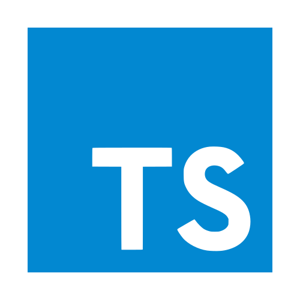
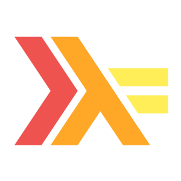

# hi, I'm vanntile! 👋

## Languages

<div>
    
    
    
    
    
    
    
    
</div>

## Who am I?

```json
{
  "handle": "@vanntile",
  "tagline": "software engineer && privacy advocate",
  "languages": {
    "programming": [
        "Go 🇬", "Python 3 🐍", "JavaScript", "TypeScript",
        "C/C++", "Haskell λ"
    ],
    "markup": ["JSON", "YAML", "HTML", "Markdown", "MDX"],
    "styling": ["CSS 💅"]
  },
  "frameworks": {
    "frontend": ["Astro 🚀", "NextJS 🇳", "React ⚛️", "Vue 🇻", "Angular 🛡️"],
    "styling": "Tailwind CSS 🍃",
    "backend": ["FastAPI ⚡", "echo", "Express", "Django", "Flask"],
    "other": ["GTK/gtkmm", "unified"]
  },
  "testing": ["Robot 🤖", "Cypress", "Jest 🃏", "JUnit"],
  "tools": ["Deno 🦕", "Node.js 🟩", "npm 📦", "Docker 🐳", "Jenkins 🎩"],
  "standardsAndParadigms": [
      "FOSS", "OpenAPI", "REST", "GraphQL",
      "semantic web", "functional programming"
  ],
  "platforms": [
    "GitHub 🐙", "GitLab 🦊", "Bitbucket 🪣",
    "Linode", "Mastodon 🐘"
  ],
  "designToolsAndKnowledge": ["Inkscape", "Figma", "GIMP", "SVG"],
  "others": {
    "versioning": "git",
    "operatingSystem": {
      "family": "Linux 🐧",
      "distro": "Pop!_OS"
    },
    "editor": "neovim",
    "formattersAndLinters": [
      "Prettier", "ESLint", "gofumpt", "clang-format", "commitlint"
    ],
    "preferredTheme": "dark",
    "dotfiles": true
  }
}
```

